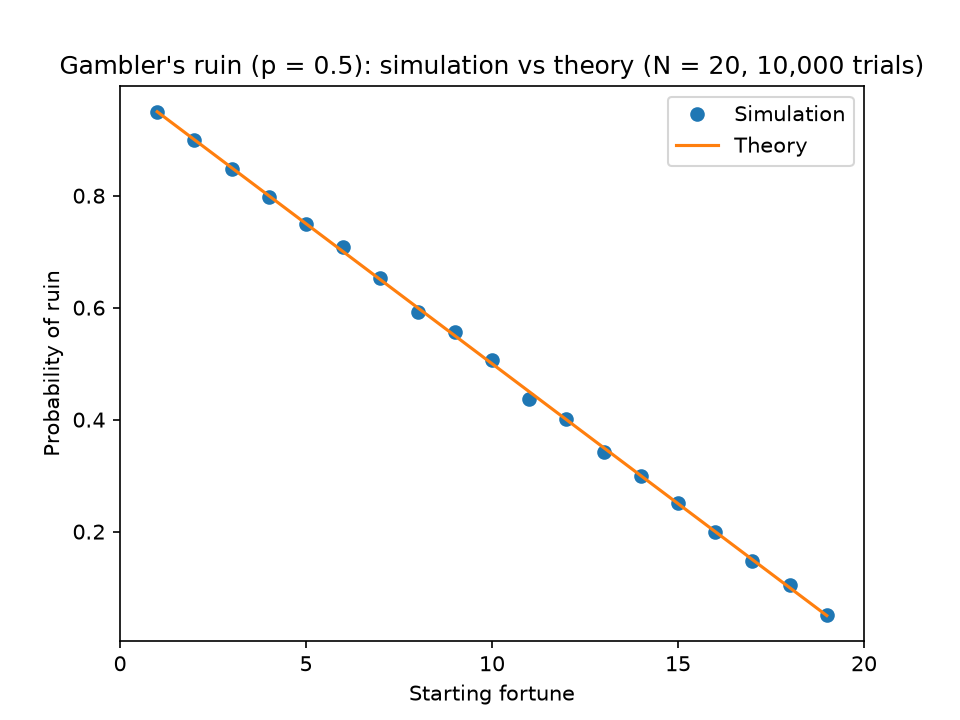
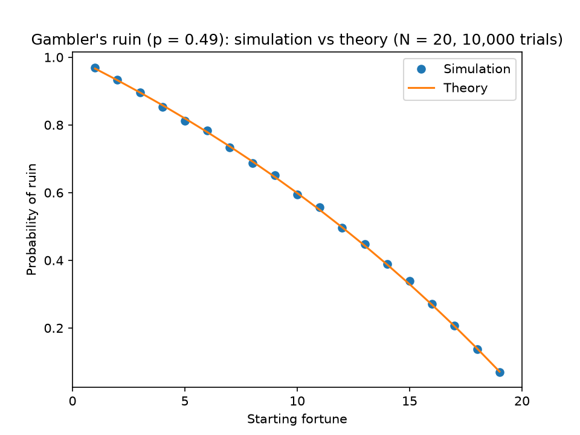

# Gambler's ruin: Monte Carlo Simulation

## The problem
The Gambler's ruin problem goes as follows: consider that a gambler at each play has a probability p to win 1 unit and 
probability q = 1 - p to lose 1, each play's outcome being independent of each other. The player has a fixed amount of 
units "start" at the start of the game. The game stops when his fortune reaches a fixed goal amount "N", or when it 
reaches 0: the gambler is then "ruined". 

## What my code does  
It plays a fixed "trials" amount of games (here 10 000) for each starting amount from 1 to N - 1 (here N = 20). It 
estimates the probability of ruin (the share of games that end with the gambler ruined). It then computes the 
same probability from the theoretical formula ( in "theory.py" file ). Finally, it puts all the values in 2 lists and 
compares the probabilities for each starting amount. 

## Results

With the graphs, we can see that both curves (of the simulation and theory) have almost the same shape, as expected.

### Fair game ( p = 0.5 )

We can see that both curves align (simulation is close to theory) and resemble decreasing linear functions meaning 
that, the more the starting fortune increases, the lower the probability of ruin.

### Unfair game ( p = 0.49 )

Again, both curves align, but this time they aren't linear and more curvy, more "concave" and higher, meaning that for 
the same starting value, the probability of ruin is higher.

## The formulas
`( (q/p)^N - (q/p)^start )/((q/p)^N - 1)` is a formula that appears in De Moivre's work "De Mensura 
Sortis" (1711), and describes the theoretical probability of ruin. The formula for a fair game where p = q = 
1/2 is given by ` 1 - start / N `. It is found by taking the limit of the first formula where q/p goes to 1 and then 
using l'Hopital's rule to find the result.

Source: [De Mensura Sortis, Internet Archive](https://archive.org/details/paper-doi-10_1098_rstl_1710_0018/page/n13/mode/2up) ( look for the vinculum at the top left of page 228 ).

## Usage 
Put `simulation.py` and `theory.py` in the same folder, install matplotlib (`pip install matplotlib`), then run `python simulation.py`.
The program asks for the probability p of winning a round.

## Conclusion
The probability of ruin is quite sensitive to the value p. Even a slight disadvantage (p = 0.49) clearly raises the
probability of ruin.
